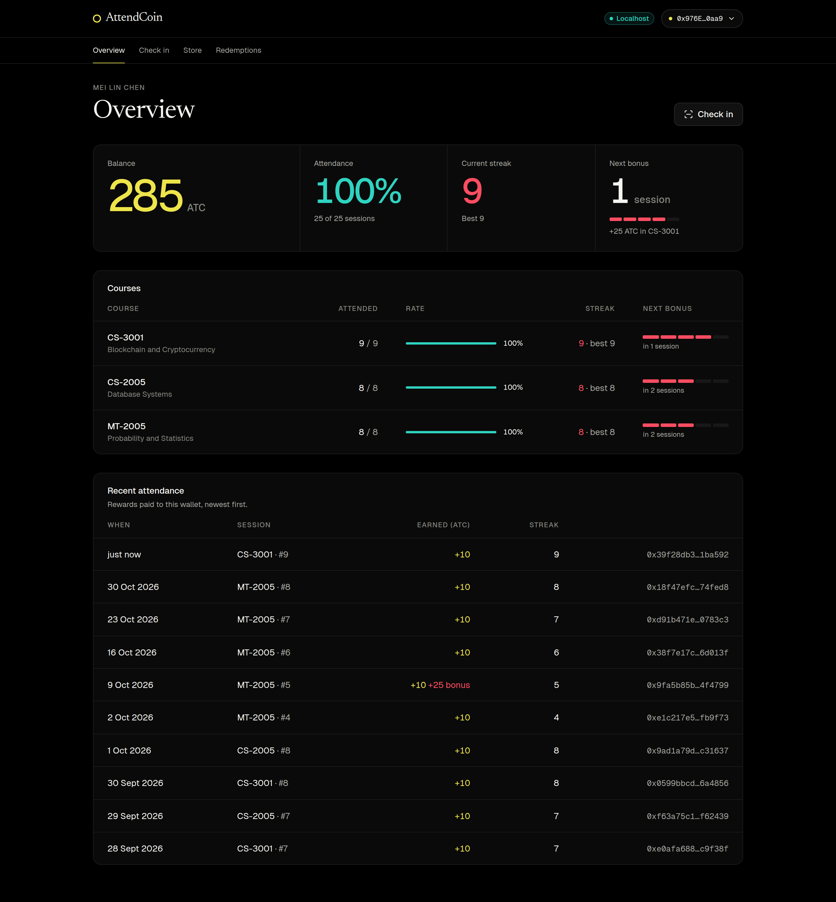

# AttendCoin

AttendCoin is an ERC-20 token that students earn by turning up to class: the teacher shows a rotating QR code, students sign it from their wallet, and the attendance contract mints a reward plus a bonus for every streak. Students spend ATC at campus vendors, and admins manage people, courses and the token economy from the same app.



## How it fits together

- **Contracts** (`contracts/`, Solidity 0.8.28, OpenZeppelin)
  - `AttendCoin` is the capped, pausable token. Transfers can be limited to campus wallets.
  - `AttendanceManager` holds students, courses and sessions. It verifies EIP-712 check-in signatures and mints the rewards.
  - `RewardStore` is the catalogue. Redeeming holds the ATC in escrow; when a vendor fulfils the redemption, the ATC is burned or sent to the treasury.
- **Backend** (`backend/`, Node + Express)
  - Checks scanned QR tickets and queues check-ins until the teacher submits them on-chain in one transaction.
  - Stores off-chain profiles and course titles in a JSON file.
  - Holds no private keys. Every write is signed by a wallet in the browser.
- **Frontend** (`frontend/`, React + Vite + ethers v6)
  - Has dashboards for students, teachers, vendors and admins. Roles are read from the chain for whichever wallet is connected.

A check-in goes through these steps:

1. The teacher's browser signs a short-lived ticket with a per-session key.
2. The student's wallet signs the check-in.
3. The backend validates and queues it.
4. The teacher submits the batch.
5. The contract checks both signatures and pays out.

## Prerequisites

- Node 24 and npm.
- A browser wallet such as MetaMask, only for Sepolia. Locally, the app can use the Hardhat accounts directly.
- For Sepolia: an RPC URL (Alchemy, Infura or similar), a funded deployer key and an Etherscan API key.

## Local quickstart

Use four terminals, all starting from the project root.

```sh
# 1. Install
npm install
(cd backend && npm install && cp .env.example .env)
(cd frontend && npm install && cp .env.example .env)

# 2. Chain. The seed lays out a ten-week term, so the node has to start in the past.
CHAIN_START_DAYS_AGO=70 npx hardhat node
```

```sh
# 3. Contracts. This writes addresses to deployments/, frontend/ and backend/.
npm run deploy:local
```

```sh
# 4. API on :4000
cd backend && npm start
```

```sh
# 5. Demo data, with the backend running: 8 students, 3 courses, a term of
#    sessions, store items, and one CS-3001 session left open.
npm run seed:local

# 6. App on :5173
cd frontend && npm run dev
```

Open http://localhost:5173. `frontend/.env.example` sets `VITE_DEV_WALLETS=true`, which adds the Hardhat accounts to the wallet menu:

| Account | Role |
| --- | --- |
| 0 | admin |
| 1, 2 | teachers |
| 3 | vendor |
| 4 to 11 | students (account 6 is Mei Lin Chen) |

Restarting the node wipes the chain. When that happens:

1. Delete `backend/data/db.json`.
2. Deploy again.
3. Seed again.

If you seed a node that was not started with `CHAIN_START_DAYS_AGO`, the seed stops and tells you what to do.

## Deploying to Sepolia

Put these in `.env` at the project root:

```sh
SEPOLIA_RPC_URL=https://eth-sepolia.g.alchemy.com/v2/<key>
DEPLOYER_PRIVATE_KEY=0x...
ETHERSCAN_API_KEY=...
# Optional. Both default to the deployer.
ADMIN_ADDRESS=0x...
TREASURY_ADDRESS=0x...
```

Deploy:

```sh
npm run deploy:sepolia
```

This writes `deployments/sepolia.json` and copies it to `frontend/src/contracts/` and `backend/src/`. If `ADMIN_ADDRESS` differs from the deployer, the script grants it admin on all three contracts. Revoke the deployer's role yourself once you have confirmed it.

Verify each contract with the addresses from `deployments/sepolia.json`. `DEPLOYER` is the deployer's address, and `TREASURY` defaults to it too.

```sh
npx hardhat verify --network sepolia <AttendCoin> <DEPLOYER> 10000000000000000000000000
npx hardhat verify --network sepolia <AttendanceManager> <DEPLOYER> <AttendCoin>
npx hardhat verify --network sepolia <RewardStore> <DEPLOYER> <AttendCoin> <AttendanceManager> <TREASURY>
```

The second argument to AttendCoin is the supply cap: 10 million ATC in wei.

To point the apps at Sepolia:

- In `backend/.env`, set `NETWORK=sepolia` and `RPC_URL`.
- In `frontend/.env`, set the following and turn off dev wallets:

  ```sh
  VITE_NETWORK=sepolia
  VITE_RPC_URL=...
  VITE_DEV_WALLETS=false
  ```

History queries start from the `deployBlock` recorded at deploy time, because public RPCs reject log scans from genesis.

## Build check

```sh
cd frontend && npm run build      # type-check and production build
```

To retake the screenshots in `docs/screenshots/`:

1. Start from a fresh seed with the stack running.
2. Run the commands below. The script drives a check-in, a redemption and a fulfilment, so it changes the chain.

```sh
npm install --prefix /tmp/shots puppeteer-core@23 jsqr pngjs
SHOTS_MODULES=/tmp/shots/node_modules node scripts/screenshots.mjs
```

## Layout

```
contracts/      AttendCoin, AttendanceManager, RewardStore and their interfaces
scripts/        deploy, seed, ABI export and the screenshot script
deployments/    addresses per network, plus the seed summary for localhost
backend/        Express API: check-in queue, profiles, course details
frontend/       React app with student, teacher, vendor and admin dashboards
docs/           report and screenshots
```
